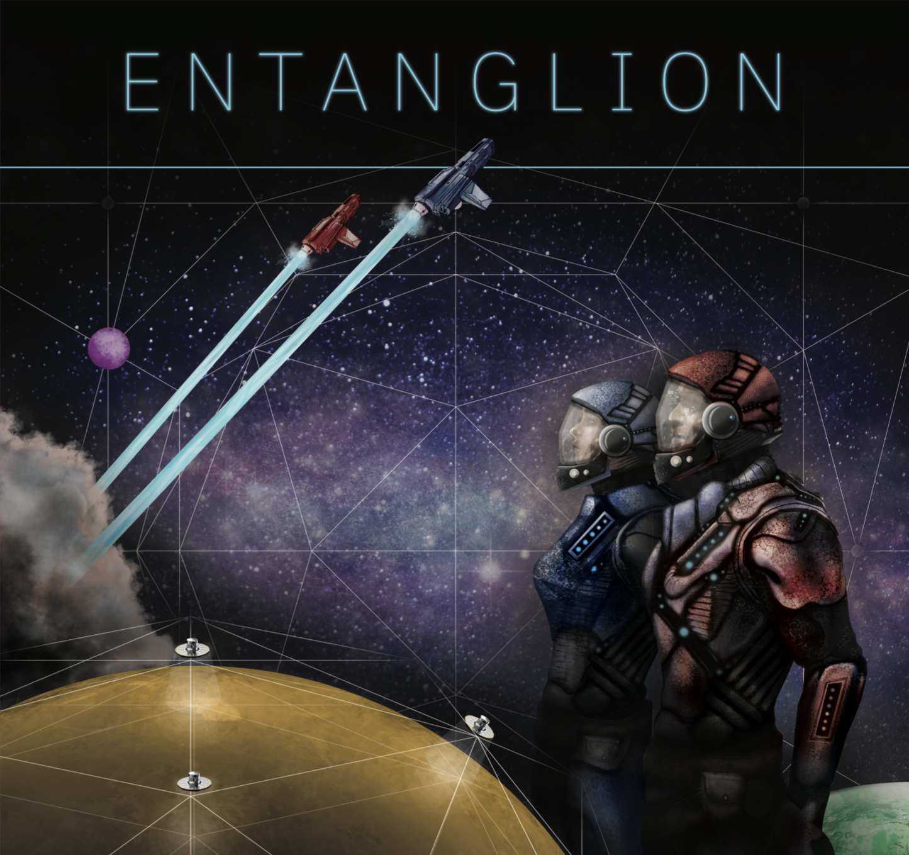
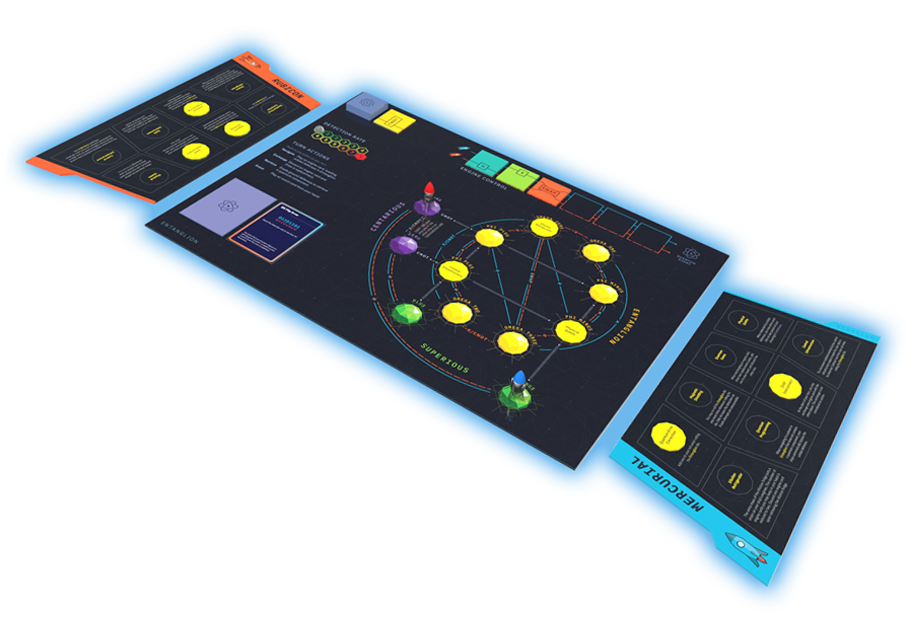

# Entanglion

> Um jogo da IBM Research

**2 JOGADORES | A PARTIR DE 14 ANOS | 45 MINUTOS**

[Entanglion](http://ibm.biz/entanglion) aguarda suas habilidades de navegação espacial e planejamento estratégico para explorar uma nova galáxia e reconstruir um antigo computador quântico. [Entanglion](http://ibm.biz/entanglion) é um jogo de tabuleiro cooperativo projetado para dois jogadores. Aprenda sobre computação quântica enquanto você e seu parceiro trabalham juntos para navegar pelas três galáxias do universo quântico, evitar a detecção dos mecanismos de defesa deixados pelos antigos e reconstruir o computador quântico.

Acha que está pronto para o desafio?



## Bem-vindo ao universo quântico, Capitão!
Parabéns, seu capitão se aposentou e deixou você no comando do negócio galáctico de transporte de cargas! Agora é hora de fazer alguns aprimoramentos.

Há anos, você está obcecado com rumores sobre uma antiga tecnologia de computação quântica que poderia revolucionar o transporte de carga interestelar. Se os rumores forem verdadeiros, ela permitiria que suas naves calculassem rotas no hiperespaço em questão de segundos! Só há um problema: os antigos desmontaram seu computador quântico por temerem seu poder, e deixaram os componentes espalhados pelos planetas na galáxia fortemente protegida de Entanglion.

Se quiser reconstruir essa tecnologia incrível, você precisará navegar com suas naves até a galáxia de Entanglion e superar as defesas deixadas pelos antigos. A boa notícia é que seu antigo capitão deixou dinheiro suficiente para equipar suas naves com motores quânticos — necessários para entrar em Entanglion. A má notícia é que, sem um computador quântico para guiá-los, esses motores podem ser um pouco… imprevisíveis.

Quer saber mais? Leia a história completa de Entanglion, [O Misterioso Destino dos Quantics](jogo/Historia.md).

## Obtendo Entanglion
Entanglion é um projeto de código aberto, e você pode criar sua própria cópia do jogo baixando e imprimindo os materiais. Alternativamente, você pode adquirir Entanglion em The Game Crafter.

🚀 **[Baixar o Guia de Impressão e Montagem do Entanglion](recursos)**

💰 **[Comprar Entanglion em The Game Crafter](https://www.thegamecrafter.com/games/entanglion1)**



## Jogando Entanglion
Por favor, leia o [livro de regras](jogo) para entender como jogar Entanglion. A versão online do livro de regras deve ser considerada a fonte oficial, e quaisquer erratas encontradas no guia impresso serão documentadas nessa página.

## Ensinando Entanglion
Se você é um educador e gostaria de usar Entanglion como parte de um currículo de ensino, por favor [entre em contato conosco](mailto:entanglion@us.ibm.com). Adoraríamos conhecer seus planos para o uso de Entanglion e talvez possamos apoiar seus esforços.

## Expandindo Entanglion
Entanglion é um projeto de código aberto desenvolvido pela IBM Research para ensinar os princípios da computação quântica. Recebemos contribuições da comunidade para modificar e expandir o jogo. Se você gostaria de desenvolver uma expansão de Entanglion, confira nosso [guia de expansão](expansoes).

## Citando Entanglion
Se desejar citar Entanglion em um trabalho acadêmico, use a seguinte referência:

> Justin D. Weisz, Maryam Ashoori, and Zahra Ashktorab. 2018. Entanglion: A Board Game for Teaching the Principles of Quantum Computing. In Proceedings of the 2018 Annual Symposium on Computer-Human Interaction in Play (CHI PLAY '18). ACM, New York, NY, USA, 523-534. DOI: https://doi.org/10.1145/3242671.3242696

```
@inproceedings{Weisz:2018:EBG:3242671.3242696,
author = {Weisz, Justin D. and Ashoori, Maryam and Ashktorab, Zahra},
title = {Entanglion: A Board Game for Teaching the Principles of Quantum Computing},
booktitle = {Proceedings of the 2018 Annual Symposium on Computer-Human Interaction in Play},
series = {CHI PLAY '18},
year = {2018},
isbn = {978-1-4503-5624-4},
location = {Melbourne, VIC, Australia},
pages = {523--534},
numpages = {12},
url = {http://doi.acm.org/10.1145/3242671.3242696},
doi = {10.1145/3242671.3242696},
acmid = {3242696},
publisher = {ACM},
address = {New York, NY, USA},
keywords = {board game, game-based learning, pedagogical tools, quantum computing education},
}
```

# Contribuidores
Entanglion foi criado pela IBM Research em Nova York.

**Design**: [Maryam Ashoori](https://github.com/maryamashoori), [Justin D. Weisz](https://github.com/jweisz)<br />
**Ilustração**: [Aaron Cox](https://twitter.com/aarrccooxx), [Michael L. Kenney](https://www.linkedin.com/in/michaelleekenney/)<br />
**Ciência Quântica**: [Jay M. Gambetta](https://github.com/jaygambetta), [Jerry M. Chow](https://github.com/jerrymchow) e [Lev S. Bishop](https://github.com/levbishop)<br />

# Licença
<a rel="license" href="http://creativecommons.org/licenses/by-nc-sa/4.0/"></a><br />Esta obra está licenciada sob uma <a rel="license" href="http://creativecommons.org/licenses/by-nc-sa/4.0/">Licença Creative Commons Atribuição-NãoComercial-CompartilhaIgual 4.0 Internacional</a>.
