# Livro de Regras do Entanglion

> Um jogo da IBM Research

**2 JOGADORES | A PARTIR DE 14 ANOS | ~45 MINUTOS**

Entanglion aguarda suas habilidades de navegação espacial e planejamento estratégico para explorar uma nova galáxia e reconstruir um antigo computador quântico.

http://ibm.biz/entanglion

> 🤔 Ficou confuso com alguma regra? Consulte as [errata](Errata.md) para esclarecimentos e atualizações do jogo.

# Bem-vindo ao universo quântico, Capitão!

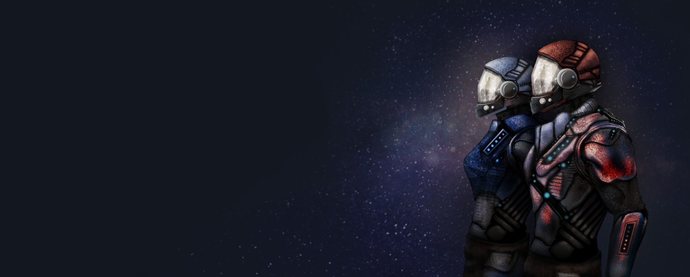

Parabéns, seu capitão se aposentou e deixou você no comando dos negócios de transporte galáctico dele! Agora é hora de fazer algumas melhorias.

Durante anos, você ficou obcecado por rumores sobre uma antiga tecnologia de computação quântica que poderia revolucionar o transporte de cargas galácticas. Se os rumores fossem verdadeiros, permitiria que suas naves calculassem trajetórias no hiperespaço em poucos segundos! Só há um problema: os antigos desmontaram seu computador quântico por medo de que fosse muito poderoso e deixaram os componentes espalhados pelos planetas da galáxia Entanglion, fortemente protegida.

Se quiser reconstruir essa tecnologia incrível, você terá que navegar com suas naves pela galáxia de Entanglion e superar as defesas deixadas pelos antigos. A boa notícia é que seu antigo capitão deixou dinheiro suficiente para equipar suas naves com os motores quânticos necessários para entrar em Entanglion. A má notícia é que, sem um computador quântico para guiá-los, esses motores podem ser um pouco… imprevisíveis.

Acha que está pronto para o desafio?

# Objetivo

Entanglion é um jogo de tabuleiro cooperativo projetado para dois jogadores. O objetivo é reconstruir um computador quântico desenvolvido por uma raça ancestral. Trabalhe em conjunto com seu colega de equipe para navegar pelas três galáxias do universo quântico — Centarious, Superious e Entanglion — em uma jornada para coletar oito componentes do computador quântico. Tome cuidado para não ser detectado pelos mecanismos de defesa planetária que protegem os componentes!

# Conceitos de jogo

Entanglion foi projetado para expor os jogadores a vários conceitos fundamentais em computação quântica:

- **Qubits** são os blocos de construção da computação quântica.
- **Superposição** é quando um sistema quântico pode existir em uma combinação probabilística de vários estados ao mesmo tempo.
- **Emaranhamento** ocorre quando o estado de um qubit se correlaciona com o estado de outro qubit.
- **Medição** é o processo de observação do valor clássico de um qubit.
- **Erro** ocorre quando ruído aleatório no sistema quântico perturba o valor medido de um qubit.

Entanglion também expõe os jogadores aos diferentes tipos de componentes de hardware e software envolvidos na construção de um computador quântico real.

Uma discussão adicional de como Entanglion se relaciona com a computação quântica real pode ser encontrada no final deste livro.

# Configuração do jogo

1. **Coloque o tabuleiro do jogo e os tabuleiros das naves**. Coloque o tabuleiro do jogo ao alcance de cada jogador e distribua os tabuleiros das naves para cada jogador.
2. **Coloque os componentes quânticos**. Embaralhe os componentes quânticos e coloque-os com a face para cima em cada planeta na galáxia Entanglion, um por planeta.
3. **Embaralhe a pilha de cartas de motor**. Separe a carta PROBE e embaralhe as cartas de motor restantes. Coloque a carta PROBE virada para baixo na pilha de motor e, em seguida, coloque as cartas restantes em cima, viradas para baixo.
4. **Prepare o baralho de eventos quânticos**. Separe a carta Embaralhamento Quântico e embaralhe as cartas de evento restantes. Distribua três cartas de evento viradas para baixo no baralho de eventos quânticos. Em seguida, coloque a carta Embaralhamento Quântico virada para baixo no baralho. Por fim, coloque as cartas de evento restantes viradas para baixo no baralho.
5. **Defina a taxa de detecção inicial**. Coloque o token de taxa de detecção na escala de taxa de detecção. Para um jogo fácil, comece com uma taxa de detecção de 1 ou 2. Para um jogo mais desafiador, comece com uma taxa de detecção de 3. Se a taxa de detecção atingir o nível final (X) antes que o computador quântico tenha sido construído, o jogo termina em derrota.
6. **Determine o primeiro jogador**. Determine o primeiro jogador fazendo cada jogador rolar o dado de Entanglion (8 faces). O jogador com o número mais alto começa. Role novamente em caso de empate.
7. **Determine as posições iniciais das naves**. Começando pelo primeiro jogador, role o dado de Centarious para posicionar cada nave espacial (0 vai para ZERO, 1 vai para ONE). Esse processo é semelhante à inicialização de um sistema quântico.
8. **Compre cartas de motor**. Começando pelo primeiro jogador, cada jogador compra três cartas de motor para a mão. As cartas de motor podem ser mantidas com a face para cima.

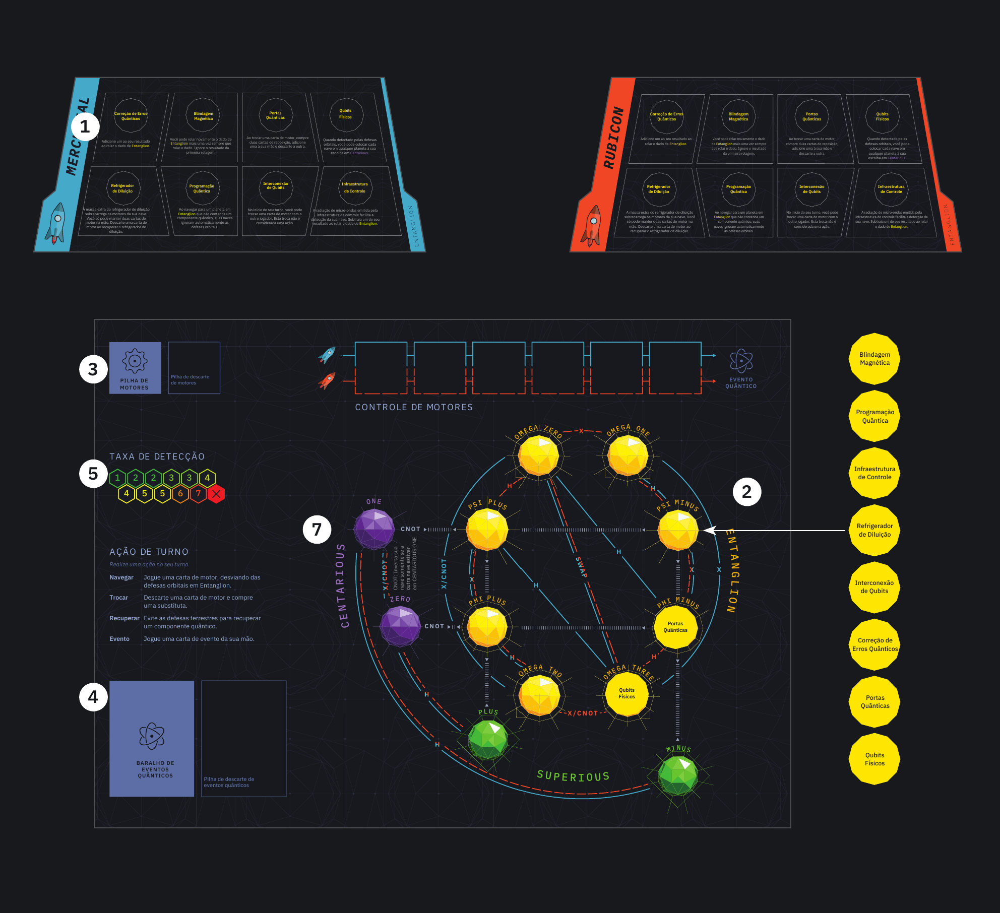

# Materiais

**Tabuleiros**
- 1 tabuleiro do jogo
- 2 tabuleiros das naves

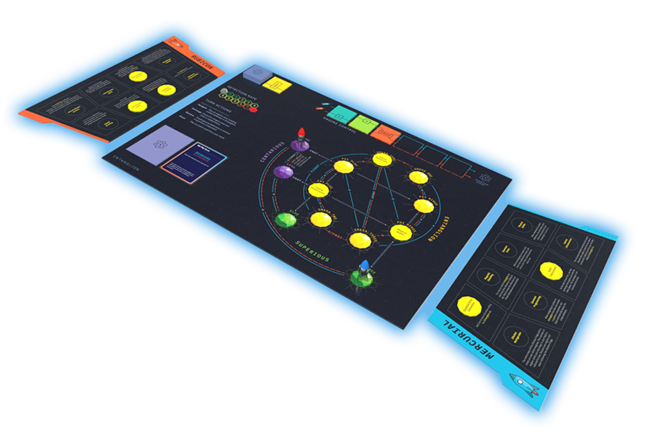

**Cartas**
- 24 cartas de motor (8 H, 7 CNOT, 5 X, 3 SWAP, 1 PROBE)

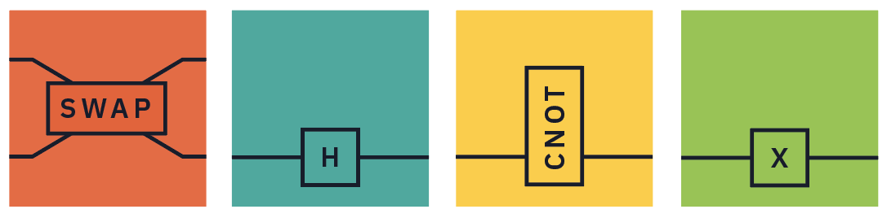

- 9 cartas de evento

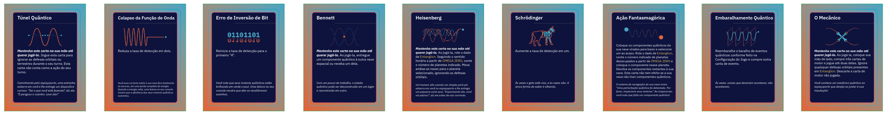

**Peças**
- 1 token de taxa de detecção
- 8 componentes quânticos

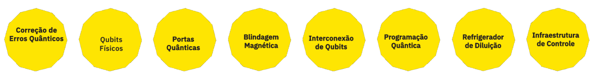

- 1 dado de Centarious (d6 binário roxo)
- 1 dado de Entanglion (d8 amarelo)
- 2 tokens de nave espacial

**Livro de Regras**

# Cartas de motor

As cartas de motor são usadas para navegar suas naves pelo universo quântico. Os caminhos de navegação no tabuleiro do jogo estão marcados com a(s) carta(s) necessária(s) para percorrê-los (por exemplo, "X/CNOT" significa que X ou CNOT podem ser usados para percorrer esse caminho). Em alguns casos, apenas uma nave espacial pode percorrer um caminho. As cartas de motor podem ser jogadas sem efeito quando nenhuma transição é mostrada no tabuleiro.

**X**. X é usado para navegar entre ZERO e ONE e dentro da galáxia Entanglion.

**H**. H é usado para viajar entre Centarious e Superious e dentro da galáxia Entanglion.

**SWAP**. Fora de Entanglion, SWAP troca as posições das duas naves espaciais. Dentro de Entanglion, SWAP apenas faz a transição das naves entre OMEGA ZERO e OMEGA THREE.

**CNOT**. CNOT é usado para entrar na galáxia Entanglion e navegar dentro dela. Também inverte a posição de sua nave espacial em Centarious, mas somente quando a outra nave espacial está orbitando ONE.

**PROBE**. Sempre que PROBE for comprado, suas naves foram descobertas por uma sonda defensiva ancestral! Role o dado de Entanglion. Se o resultado for menor que 4 (após contabilizar os efeitos dos componentes quânticos), aumente a taxa de detecção em um. Caso contrário, PROBE não tem efeito. Descarte PROBE e compre uma carta de motor substituta.

> Oriente as cartas de motor nos espaços de controle de motor de modo que as linhas na carta se alinhem com a linha de sua nave espacial.

> Quando a pilha de motor se esgotar, embaralhe imediatamente as cartas de motor na pilha de descarte para recompor a pilha. Inclua PROBE no embaralhamento — não o coloque no fundo da pilha.

# Visão geral do turno

Realize _uma_ das seguintes ações em seu turno:

1. **Navegar**. Jogue uma carta de motor no controle de motor para navegar pela galáxia e compre uma substituta. Você só pode jogar cartas de motor para sua própria nave.
2. **Trocar**. Descarte uma carta de motor da sua mão e compre uma substituta.
3. **Recuperar**. Role o dado de Entanglion para tentar recuperar um componente quântico, se houver um presente no planeta visitado.
4. **Evento**. Jogue uma carta de evento da sua mão (se possuir uma).

> Os jogadores não podem passar a vez — devem realizar uma das ações acima.

# Entrando e saindo de Entanglion

Para entrar em Entanglion, uma nave precisa estar em Centarious e a outra precisa estar em Superious. Apenas a nave em Centarious pode usar CNOT para entrar em Entanglion. Os caminhos para Entanglion são representados com linhas cinzas no tabuleiro.

| Nave líder (jogando CNOT) | Outra nave | Destino |
| --- | --- | --- |
| ZERO | PLUS | PHI PLUS |
| ZERO | MINUS | PHI MINUS |
| ONE | PLUS | PSI PLUS |
| ONE | MINUS | PSI MINUS |

Também é possível sair de Entanglion usando CNOT quando ambas as naves estão orbitando PHI PLUS, PHI MINUS, PSI PLUS ou PSI MINUS. A nave que joga o CNOT retorna para Centarious e a outra retorna para Superious, nos planetas indicados pelas linhas cinzas.

Exemplo: Rubicon está orbitando ZERO e Mercurial está orbitando PLUS. Quando Rubicon joga um CNOT, ambas as naves se movem para PHI PLUS.

> Fora de Entanglion, as naves se movem independentemente. Dentro de Entanglion, ambas as naves sempre se movem juntas, independentemente de qual jogador joga uma carta de motor.

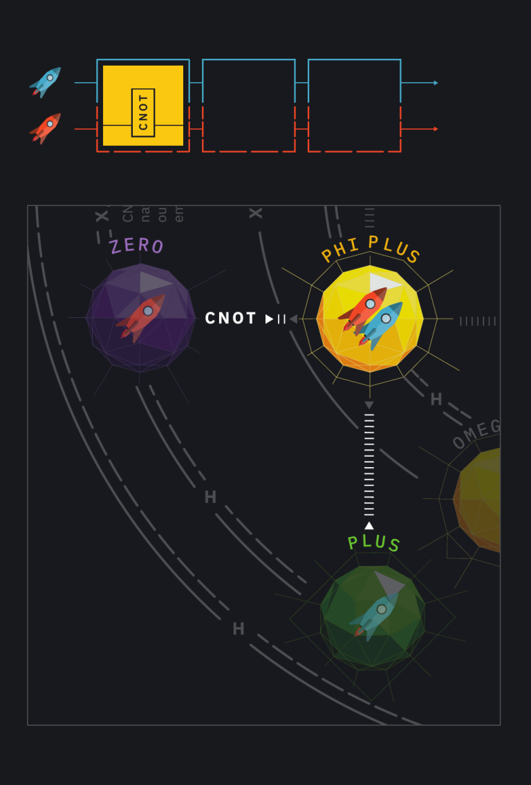

Em PHI PLUS, quando Rubicon joga CNOT, Rubicon vai para ZERO e Mercurial vai para PLUS.

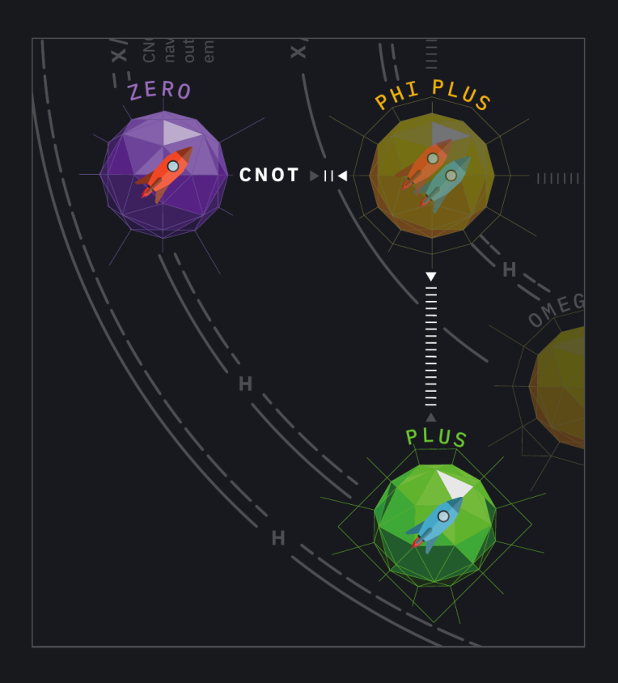

# Taxa de detecção

A taxa de detecção determina a dificuldade de evadir com sucesso as defesas planetárias. O token de taxa de detecção é usado para controlar a taxa de detecção atual. Quando a nave de um jogador é detectada pelas defesas orbitais, ou a equipe de desembarque de um jogador é detectada pelas defesas terrestres, a taxa de detecção aumenta, tornando mais fácil para as defesas de cada planeta detectar o jogador no futuro. O jogo termina quando a taxa de detecção atinge o nível final (indicado com um X).

> A taxa de detecção aumenta em um sempre que você é detectado pelas defesas orbitais ou terrestres de um planeta.

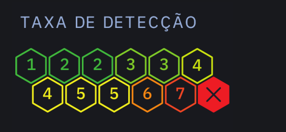

# Defesas orbitais

Os planetas em Entanglion são protegidos por defesas orbitais que escaneiam por naves procurando saquear os componentes quânticos escondidos lá. É possível evadir essas defesas usando seus motores quânticos. Se você for detectado, no entanto, seu sistema de navegação realizará manobras evasivas automaticamente e saltará para um planeta aleatório no sistema Centarious. Esse salto aciona um evento quântico.

**Quando você navega para qualquer planeta em Entanglion:** Role o dado de Entanglion. Se o resultado for maior que a taxa de detecção atual, as defesas orbitais foram evadidas. Caso contrário, realize as seguintes ações:

1. Role o dado de Centarious e mova ambas as naves para o planeta indicado. Ambas as naves saltam juntas.
2. Aumente a taxa de detecção em um.
3. Compre uma carta de evento quântico e execute a ação indicada.

> Qubits Físicos permite que você decida para quais planetas em Centarious colocar suas naves espaciais.

> Programação Quântica permite contornar as defesas orbitais quando um planeta não tem um componente quântico.

> A carta de evento Túnel Quântico permite contornar as defesas orbitais. Se você jogar esta carta após entrar na órbita de um planeta em Entanglion, não é necessário rolar o dado de Entanglion para determinar se suas naves foram detectadas pelas defesas orbitais.

> Ao entrar em Entanglion pela carta Heisenberg, você pode ignorar as defesas orbitais.

> Se você jogar uma carta de motor que não faz a transição de suas naves para um novo planeta em Entanglion, não é necessário verificar novamente se suas naves foram detectadas.

# Componentes quânticos

Há oito componentes que os jogadores devem obter para construir o computador quântico e vencer o jogo, mostrados em cada um dos tabuleiros das naves espaciais. Cada componente também concede uma habilidade especial permanente ou um impedimento para sua nave — por isso você deve planejar com seu colega de equipe para obter os componentes em uma ordem otimizada!

> Os componentes quânticos são melhorias permanentes para sua nave e alteram a jogabilidade pelo resto do jogo.

Quando suas naves estão orbitando um planeta com um componente quântico, você pode enviar uma equipe de desembarque à superfície do planeta para recuperá-lo. Os componentes quânticos são guardados por defesas terrestres automatizadas que, assim como as defesas orbitais, devem ser evadidas.

**Para realizar uma missão de recuperação:** Role o dado de Entanglion. Se o resultado for maior que a taxa de detecção atual, colete o componente e coloque-o no tabuleiro de sua nave. Caso contrário, sua equipe de desembarque foi detectada pelas defesas terrestres; aumente a taxa de detecção em um.

> Se sua equipe de desembarque falhar em recuperar um componente quântico, suas naves permanecem em órbita no planeta atual. Não é necessário realizar outra verificação de defesa orbital no próximo turno, a menos que você navegue para outro planeta que tenha defesas orbitais.

> A carta de evento Túnel Quântico permite contornar as defesas terrestres. Se você jogar esta carta durante seu turno, sua missão de recuperação foi bem-sucedida. Não é necessário rolar o dado de Entanglion para determinar se sua equipe de desembarque foi detectada pelas defesas terrestres — adicione o componente quântico à sua nave.

# Eventos quânticos

Os motores quânticos podem ser imprevisíveis às vezes! Uma vez que todos os seis espaços de controle de motor tenham sido preenchidos, realize um evento quântico no final do seu turno. Além disso, realize um evento quântico sempre que tiver sido detectado pelas defesas orbitais.

**Para realizar um evento quântico:** Compre uma carta de evento e execute as instruções. Limpe todas as cartas de motor do tabuleiro do jogo e coloque-as na pilha de descarte de motor.

> Quando Embaralhamento Quântico for comprado, reembaralhe as cartas de evento quântico conforme as instruções na configuração do jogo.

> Caso sua nave tenha sido detectada pelas defesas orbitais no mesmo turno em que preencheu todos os seis espaços de controle de motor, realize dois eventos quânticos.

# Fim do jogo

Os jogadores vencem imediatamente quando tiverem coletado todos os oito componentes do computador quântico. Os jogadores perdem imediatamente quando a taxa de detecção atingir o nível final (X).

# Sua primeira partida

Configure o tabuleiro do jogo conforme descrito na Configuração. Neste jogo, Mercurial (o jogador azul) irá primeiro. Mercurial compra três cartas: X, H e H. Rubicon compra três cartas: CNOT, SWAP e X. Ambas as naves começam em ZERO.

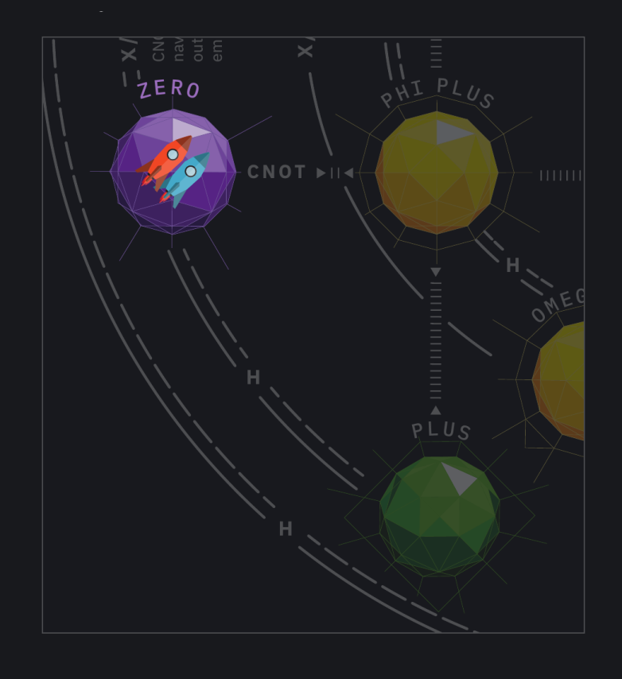

1. Mercurial joga um H para navegar até PLUS. Mercurial compra X como carta substituta.

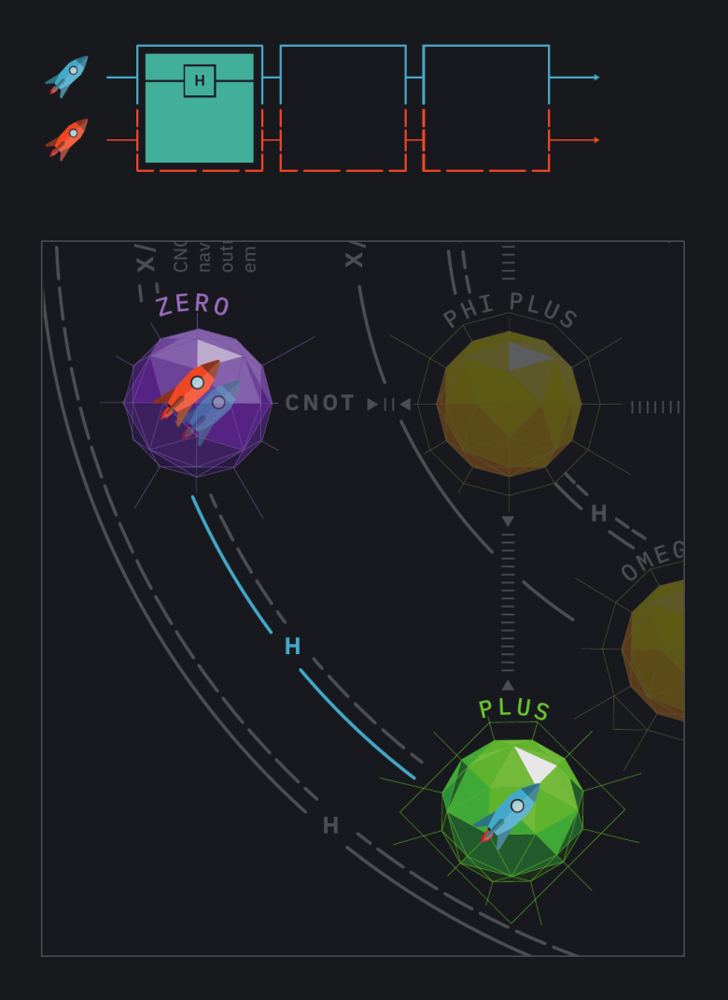

2. Rubicon joga CNOT para navegar ambas as naves até PHI PLUS. Rubicon compra H como carta substituta. Após chegar a um planeta em Entanglion, Rubicon deve rolar o dado de Entanglion para evadir as defesas orbitais. Como a taxa de detecção é 1, Rubicon precisa rolar 2 ou mais. Rubicon rola o dado de Entanglion e obtém 3, justo o suficiente para evadir a detecção!

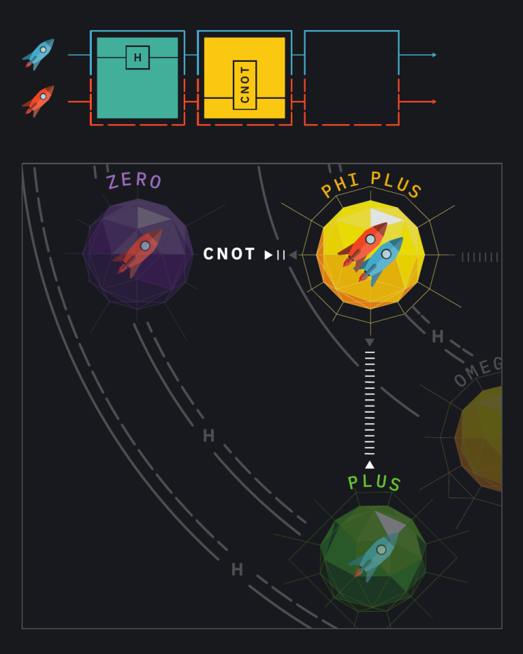
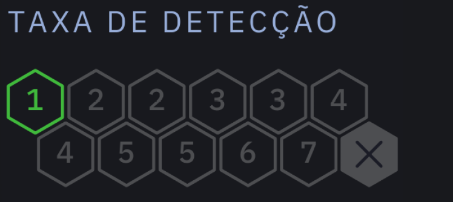

3. Mercurial decide recuperar as Portas Quânticas presentes em PHI PLUS. Mercurial rola 6, muito acima da taxa de detecção de 1, e recupera o componente com sucesso.

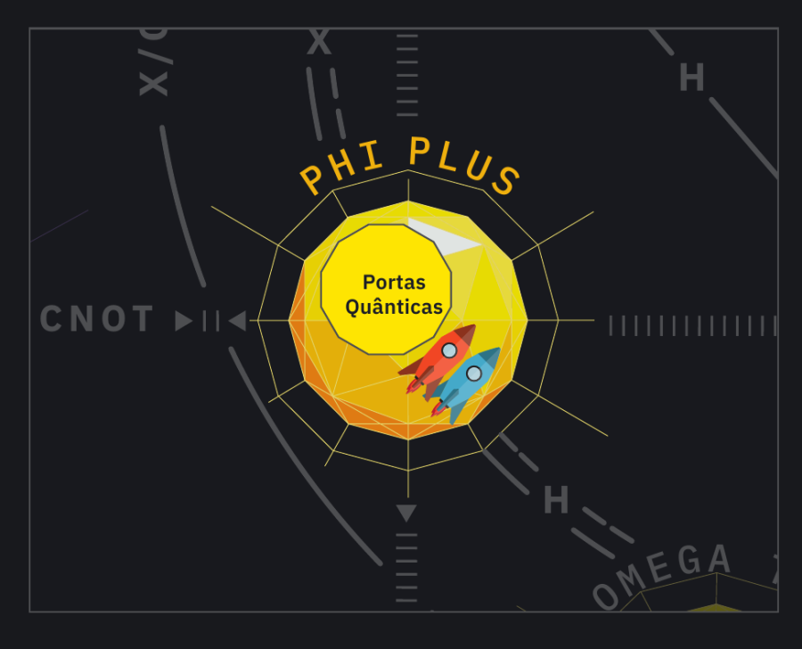

4. Rubicon decide que o próximo destino é OMEGA TWO e joga um H para navegar ambas as naves até lá.

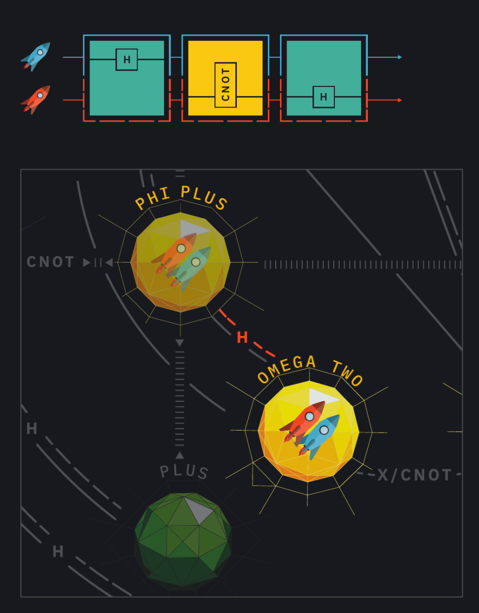

Rubicon rola o dado de Entanglion e obtém 1. As naves foram detectadas, então devem recuar! Rubicon rola 1 no dado de Centarious, então ambas as naves saltam de volta para ONE. Como foram detectadas, a taxa de detecção aumenta em 1 e um evento quântico é acionado. Rubicon compra uma carta de evento quântico — Heisenberg — que pode ser usada em um turno futuro.

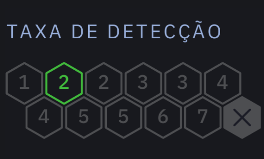

O jogo continua até que Rubicon e Mercurial tenham coletado todos os componentes quânticos em Entanglion, ou até que a taxa de detecção atinja o nível final.

# Como Entanglion se relaciona com a computação quântica

Entanglion modela vários aspectos de um computador quântico de 2 qubits. Especificamente, as duas naves espaciais representam dois qubits, e cada planeta em cada galáxia representa um estado diferente desses qubits. As cartas de motor representam as portas lógicas quânticas usadas para fazer a transição dos qubits para diferentes estados.

A galáxia Centarious representa os estados clássicos de 0 e 1, escritos em "notação ket" como |0⟩ (ZERO) e |1⟩ (ONE). A galáxia Superious representa estados de superposição quântica, conhecidos como |+⟩ (PLUS) e |−⟩ (MINUS). A galáxia Entanglion representa estados de emaranhamento. Quatro dos estados emaranhados — |Ψ+⟩ (PSI PLUS), |Ψ−⟩ (PSI MINUS), |Φ+⟩ (PHI PLUS) e |Φ−⟩ (PHI MINUS) — são conhecidos como os [estados de Bell](https://pt.wikipedia.org/wiki/Estados_de_Bell). Os outros estados emaranhados, que rotulamos de |ω0⟩ (OMEGA ZERO) a |ω3⟩ (OMEGA THREE), são estados adicionais alcançáveis pela operação combinada das portas X, H, SWAP e CNOT.

A exigência de que ambas as naves se movam juntas dentro de Entanglion é resultado do fato de que, para estados emaranhados, o estado do sistema é mais complexo do que uma simples combinação dos estados dos qubits individuais. Esta é uma das principais formas em que a mecânica quântica difere da física clássica.

## Cartas de motor

As cartas de motor representam _alguns_ dos diferentes tipos de portas lógicas quânticas usadas por computadores quânticos.

- **X**. A porta X inverte o valor de um qubit. Também é conhecida como porta de inversão de bit.
- **SWAP**. SWAP troca os valores dos dois qubits.
- **CNOT**. CNOT significa "NOT Controlado". Precisa de dois qubits para funcionar: um qubit é designado como "alvo", que é invertido se o outro qubit, conhecido como "controle", tiver valor 1.
- **H**. A porta Hadamard é usada para criar ou colapsar a superposição. É uma das portas mais importantes na computação quântica.

## Componentes quânticos

Os componentes quânticos em Entanglion representam diferentes componentes físicos ou lógicos necessários para construir um computador quântico real.

- **Qubits Físicos**. Assim como os processadores de computadores clássicos são implementados via transistores de hardware, os processadores quânticos são implementados via qubits de hardware. Há [diversas formas](https://pt.wikipedia.org/wiki/Qubit) pelas quais cientistas estão criando qubits físicos, incluindo junções Josephson, armadilhas de íons e pontos quânticos.
- **Interconexão de Qubits**. Os qubits devem estar fisicamente conectados entre si para se tornarem emaranhados.
- **Refrigerador de Diluição**. Os qubits físicos devem ser mantidos a temperaturas muito baixas — mais frias até que o espaço sideral — para manter sua coerência. Os refrigeradores de diluição conseguem resfriar qubits físicos a temperaturas tão baixas quanto 2 milikelvin.
- **Portas Quânticas**. Na computação clássica, portas lógicas como AND, OR, NOT e NAND são combinadas para criar computação de ordem superior. Na computação quântica, portas quânticas como X, CNOT, SWAP e H são usadas para computação.
- **Programação Quântica**. Para melhorar a produtividade dos programadores quânticos, linguagens de programação quântica de alto nível são necessárias. Por exemplo, [IBM OpenQASM](https://github.com/IBM/qiskit-openqasm) permite programar um computador quântico com uma linguagem estilo assembly, e [IBM Qiskit](https://qiskit.org) permite programar um computador quântico em Python.
- **Correção de Erros Quânticos**. Os qubits físicos sofrem ruído que pode causar erros durante a medição. A [correção de erros quânticos](https://pt.wikipedia.org/wiki/Correção_de_erros_quânticos) é usada para corrigir esses erros. O principal insight da correção de erros quânticos é usar múltiplos qubits físicos para simular um qubit lógico.
- **Infraestrutura de Controle**. Os computadores quânticos precisam de alguma forma de medir o estado interno de um qubit. A infraestrutura de controle usa radiação de micro-ondas para ler o estado de um qubit e digitalizá-lo em um estado binário (0 ou 1).
- **Blindagem Magnética**. Os qubits são extremamente sensíveis a campos magnéticos aleatórios. A blindagem magnética garante que os qubits sejam protegidos de fontes externas de magnetismo.

## Cartas de evento

As cartas de evento adicionam elementos divertidos e aleatórios ao jogo. Algumas cartas de evento são nomeadas em homenagem a pessoas que fizeram contribuições significativas ao campo da física quântica e da ciência da informação quântica, como Werner Heisenberg e Erwin Schrödinger. Uma carta de evento é extra especial, nomeada em homenagem ao pesquisador da IBM Charles Bennett, um dos fundadores da teoria da informação quântica e um contribuinte-chave para a descoberta do efeito de teletransporte quântico. Outras cartas de evento são nomeadas em homenagem a efeitos quânticos, como tunelamento quântico, erros de inversão de bit, colapso da função de onda e a "ação assustadora à distância" de Einstein. Encorajamos os jogadores interessados a pesquisar essas pessoas e tópicos para aprender mais sobre a física da informação quântica!

## Defesas, medição e erro

O processo de encontrar defesas orbitais ao navegar pela galáxia Entanglion é semelhante a realizar uma medição clássica (também conhecida como medição Z) no estado quântico. Além disso, o ato de recuperar um componente quântico é semelhante a realizar uma medição de emaranhamento, também conhecida como [teste de Bell](https://pt.wikipedia.org/wiki/Experimento_de_Bell). Às vezes, o ruído no sistema quântico nos impede de obter uma medição confiável. Chamamos isso de erro de leitura. Os efeitos do ruído e dos erros são modelados pela taxa de detecção.

## Recursos adicionais

Recomendamos alguns recursos para aprender mais sobre computação quântica:

- [IBM Quantum Learning](https://learning.quantum.ibm.com/) pela IBM Research
- [Q is for Quantum](http://a.co/iJbiNS8) por T. Rudolph
- [Quantum Computing for Computer Scientists](http://a.co/cCZBoS9) por N. Yanofsky e M. Mannucci
- [Quantum Computation and Quantum Information](http://a.co/coZAko8) por M. A. Nielsen e I. L. Chuang
- [Quantum Computer Science: An Introduction](http://a.co/iYdi4Bv) por N. D. Mermin
- [Quantum Computing Since Democritus](http://a.co/1HzDIgF) por S. Aaronson

---

**Design:** Maryam Ashoori, Justin D. Weisz  
**Ilustração:** Aaron Cox, Michael L. Kenney  
**Ciência Quântica:** Jay M. Gambetta, Jerry M. Chow, Lev S. Bishop  
**Tradução para o Português (pt-BR):** [Gabriel B. de Santana](https://github.com/mpc53199), [Jorge Alexandre de Araújo](https://github.com/jorgearaujo81)

  
Este trabalho está licenciado sob uma [Licença Creative Commons Atribuição-NãoComercial-CompartilhaIgual 4.0 Internacional](http://creativecommons.org/licenses/by-nc-sa/4.0/).